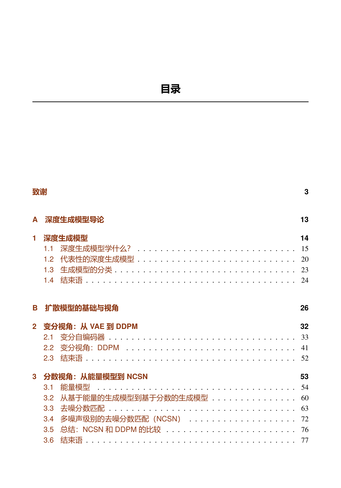
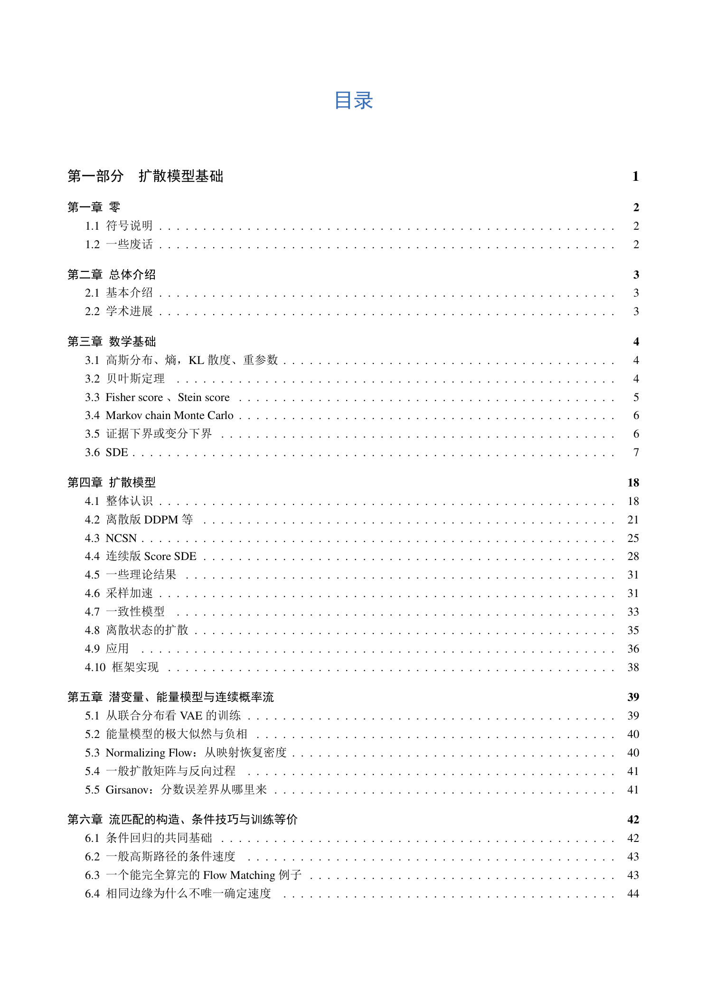

# AIGC：从扩散模型到音视频生成

**手写数学推导 · Seedance2.5完整方案人机梳理 · 中文 PDF 与 TeX 源码**

从 DDPM、Score SDE 的逐步推导，读到 Flow Matching、采样加速与联合音视频生成。适合想补齐扩散模型数学基础，或想理解视频生成网络、条件控制和训练流程的读者。

**[直接读完整书稿](StabelDiffusion.pdf) · [只读数学原理](AIGCTheory.pdf) · [Seedance 2.5 专题](Seedance25.pdf) · [《扩散模型原理》中译本](the-principles-of-diffusion-models-zh/principles-diffusion-models-zh.pdf)**

如果这些推导和资料对你有帮助，欢迎点个 **⭐ Star**，方便以后回来查阅。发现公式问题、译文问题，或有想看的主题，欢迎[提交 Issue](https://github.com/foocker/AIGC/issues)。

## 先选一本读

| 读物 | 内容与定位 | PDF | TeX |
| --- | --- | --- | --- |
| **自编 AIGC 完整书稿** | 手写数学笔记＋Seedance2.5完整方案人机梳理，包含扩散模型原理、部署与应用、音视频生成专题 | [203页](StabelDiffusion.pdf) | [源码](StabelDiffusion.tex) |
| **扩散模型理论基础** | 保留原稿推导，补充生成目标、流匹配、最优传输与桥、引导对齐、快速生成及离散扩散 | [66页](AIGCTheory.pdf) | [源码](AIGCTheory.tex) |
| **Seedance 2.5 专题** | 从完整候选网络出发，梳理表示、参考条件、联合模块、采样、长视频与训练流程 | [137页](Seedance25.pdf) | [源码](Seedance25.tex) |
| **《扩散模型原理》中文初译** | 参考书 *The Principles of Diffusion Models* 的独立译本，基于 arXiv v3，含12章与4个附录 | [436页](the-principles-of-diffusion-models-zh/principles-diffusion-models-zh.pdf) | [源码与说明](the-principles-of-diffusion-models-zh/README.md) |

## 可以从这里开始

1. **补数学基础**：读[原理篇](AIGCTheory.pdf)，沿着高斯与贝叶斯、ELBO、随机微分方程，进入 DDPM、NCSN 和连续 Score SDE，再看流匹配与快速采样。
2. **理解音视频生成方案**：读[Seedance 专题](Seedance25.pdf)，先看完整网络与联合块结构，再沿表示与条件、生成主干、目标与采样、数据与训练阅读。[阅读指南](docs/seedance-book.md)提供章节导航。
3. **对照系统教材**：读[《扩散模型原理》中文初译](the-principles-of-diffusion-models-zh/README.md)，按变分、分数、流三个视角理解扩散模型；需要核对时，同目录保留英文原稿。

## 两本书的目录预览

只展示各自的目录首页。点击图片可查看大图，完整目录见对应 PDF。

| 《扩散模型原理》中译本 | 自编书稿：手写笔记＋Seedance2.5完整方案人机梳理 |
| --- | --- |
| [](assets/principles-of-diffusion-models/toc-zh-01.png) | [](assets/principles-of-diffusion-models/toc-manuscript-01.png) |
| [阅读中译本](the-principles-of-diffusion-models-zh/principles-diffusion-models-zh.pdf) | [阅读自编完整书稿](StabelDiffusion.pdf) |

## 来源与修订

自编书稿保留原有手写笔记的章节顺序、公式展开与图示，后续增补接在原稿基础上。[原理篇修订记录](docs/theory-update.md)和[理论补充对照](docs/theory-gaps.md)列出了新增内容及参考位置。

Seedance2.5完整方案人机梳理参考 [multimodal-journey](https://github.com/foocker/multimodal-journey) 的 M00–M27，包含 VAE、流匹配、DiT、位置编码、联合音视频、多参考、编辑、长上下文、训练与推理。书中分别标注公开依据与候选设计；候选完整方案尚未经过模型训练验证。网络总图与正文顺序的说明见[专题修订记录](docs/seedance-style.md)。

《扩散模型原理》为非官方中文初译，本轮统一全书术语，重校前言、第一章和各章重点段落，并检查公式、引用和编译。逐段学术审校尚未完成。[译本说明](the-principles-of-diffusion-models-zh/README.md)记录了版本、来源和处理方式。

## 本地编译

使用 TeX Live 2025、XeLaTeX、latexmk 和 Biber，在仓库根目录运行：

```powershell
powershell -NoProfile -ExecutionPolicy Bypass -File scripts/build_books.ps1
```

成品 PDF 写到仓库根目录，中间文件保存在 `build/`。只编译完整书稿、原理篇或 Seedance 专题时，分别添加 `-Target full`、`-Target theory`、`-Target seedance`。中译本使用[独立编译脚本](the-principles-of-diffusion-models-zh/build.ps1)。
