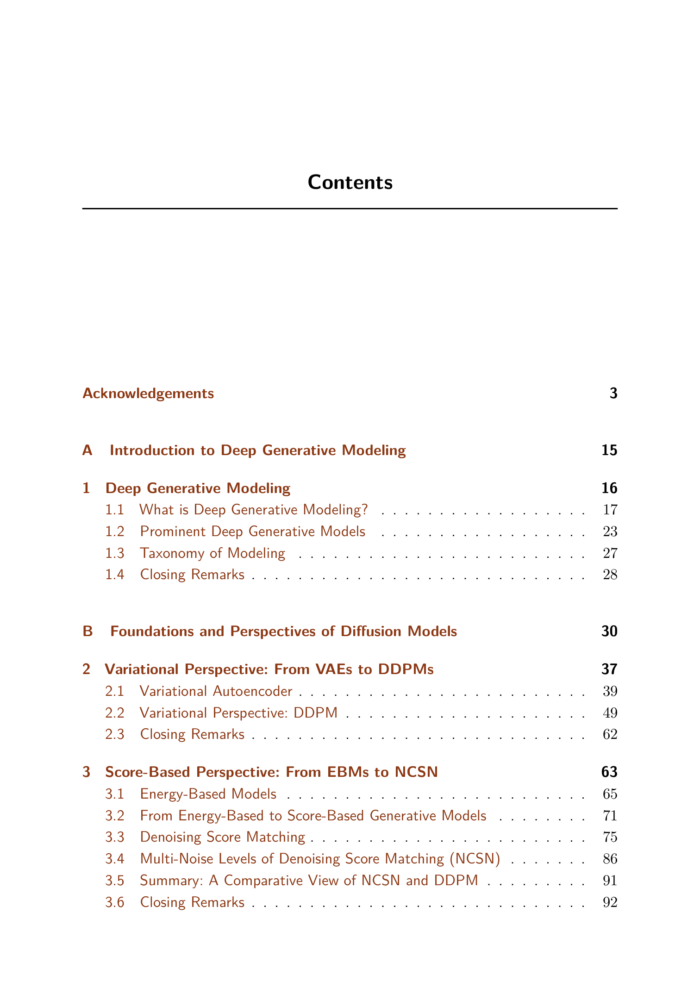
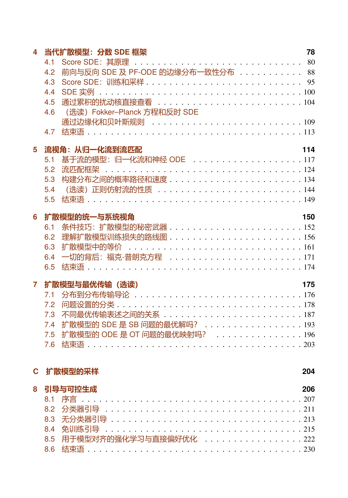
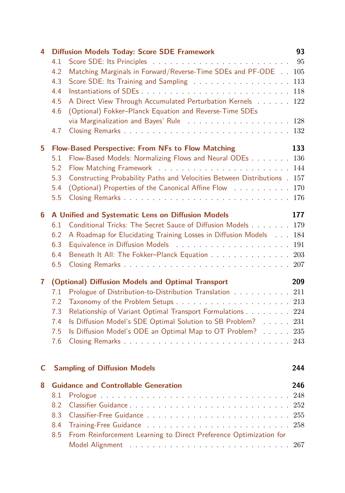
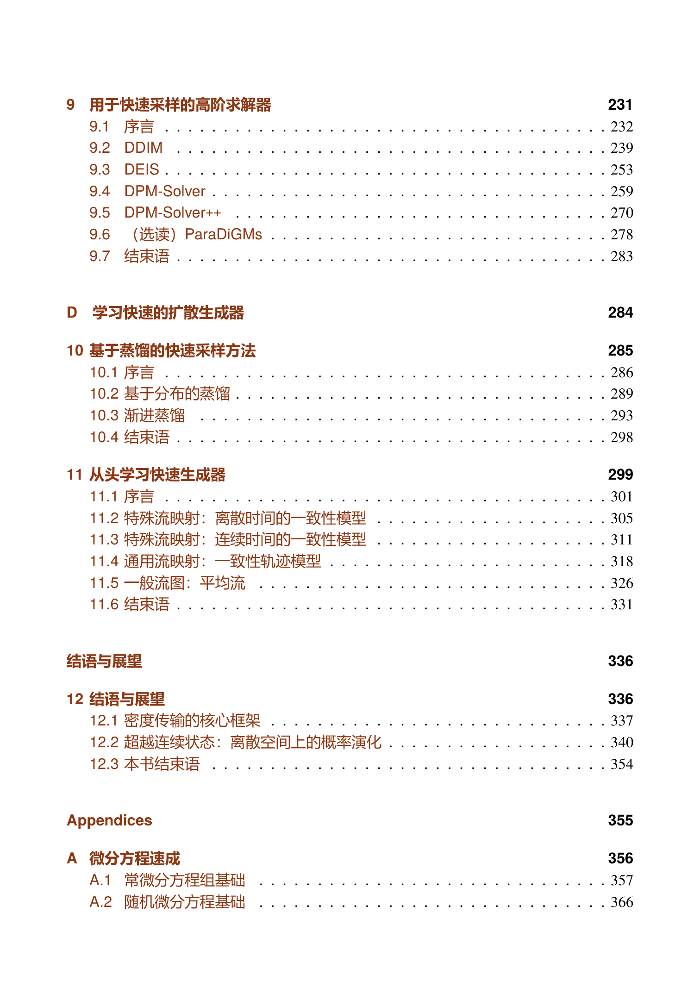
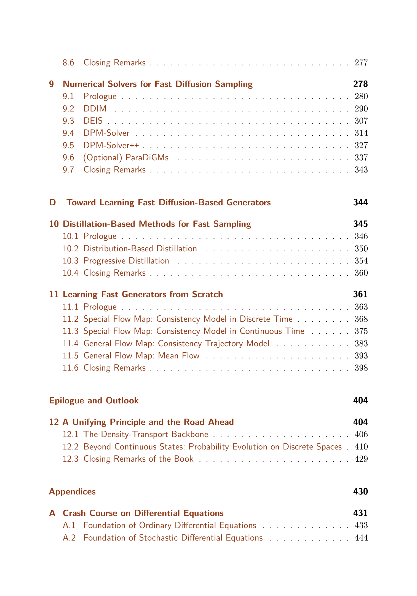
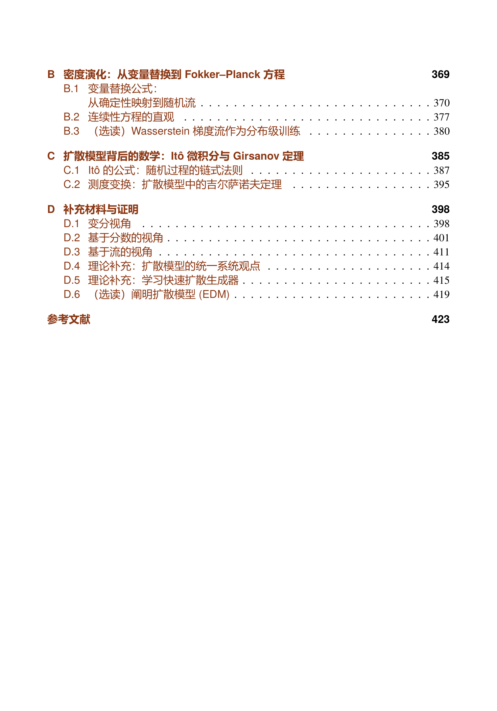
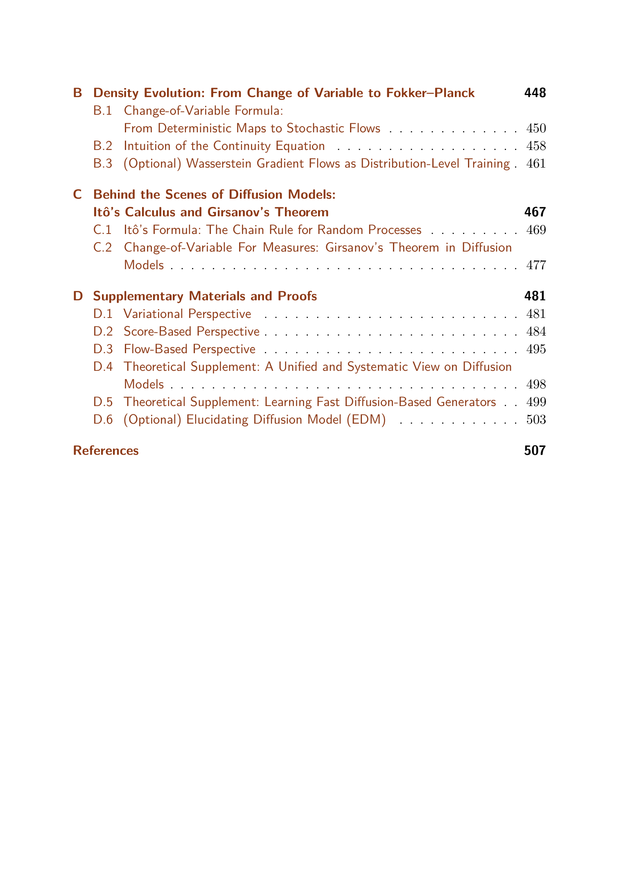

# AIGC
扩散模型算法基础文档、训练、实验、部署等仓库。

## 本地书稿（2026-11-24）

- [《扩散模型原理》独立中文初译](the-principles-of-diffusion-models-zh/README.md)：基于官方 arXiv v3 TeX，含12章、4个附录、中文PDF及原始英文源码。
- [原理篇 PDF](AIGCTheory.pdf) / [TeX 主文件](AIGCTheory.tex)：保留现有四章和详细推导，新增六章补齐参考书中的生成目标、流匹配、传输与桥、引导对齐、快速生成、离散理论。
- [完整 AIGC 书稿 PDF](StabelDiffusion.pdf) / [TeX 主文件](StabelDiffusion.tex)：原稿增补后的原理篇、简短部署与商业应用、既有 Seedance 专题。
- [Seedance 2.5 专题 PDF](Seedance25.pdf) / [TeX 主文件](Seedance25.tex)：第一章先看完整网络与联合块结构图，随后沿表示、条件、主干、采样和训练逐模块阅读。
- [阅读与编译说明](docs/seedance-book.md)：章节导航、来源边界、编译命令和本次修改说明。
- [原理篇更新说明](docs/theory-update.md)：原稿保留范围、增补位置、来源版本及检查记录。
- [理论缺口对照](docs/theory-gaps.md)：逐项列出参考书位置、此前缺失与本次新增推导。
- [Seedance 结构与行文修订](docs/seedance-style.md)：网络总图、模块新顺序与正文改写范围。

专题来源于 [multimodal-journey](https://github.com/foocker/multimodal-journey) 的 M00–M27，包含数学导读、VAE、流匹配、DiT、位置编码、联合音视频、多参考、编辑、长上下文、训练、推理和完整推测方案。公开产品信息与候选工程设计分别标记，尚未进行模型训练或业务验证。

使用 TeX Live 2025 / XeLaTeX，在仓库根目录运行：

```powershell
powershell -NoProfile -ExecutionPolicy Bypass -File scripts/build_books.ps1
```

成品写到仓库根目录，编译中间文件保存在忽略的 `build/`。只编译原理篇可加 `-Target theory`，只编译 Seedance 专题可加 `-Target seedance`。

## 《扩散模型原理》目录对照

[中文初译 PDF](the-principles-of-diffusion-models-zh/principles-diffusion-models-zh.pdf) / [英文原版 PDF（arXiv v3）](the-principles-of-diffusion-models-zh/original/principles-diffusion-models-v3-en.pdf)。两版目录均为 PDF 第2–5页；点击截图可查看大图。

| 中文译本 · 目录第1页 | 英文原版 · 目录第1页 |
| --- | --- |
| [](assets/principles-of-diffusion-models/toc-zh-01.png) | [](assets/principles-of-diffusion-models/toc-en-01.png) |

<details>
<summary>展开其余目录页（第2–4页）</summary>

| 中文译本 | 英文原版 |
| --- | --- |
| [](assets/principles-of-diffusion-models/toc-zh-02.png) | [](assets/principles-of-diffusion-models/toc-en-02.png) |
| [](assets/principles-of-diffusion-models/toc-zh-03.png) | [](assets/principles-of-diffusion-models/toc-en-03.png) |
| [](assets/principles-of-diffusion-models/toc-zh-04.png) | [](assets/principles-of-diffusion-models/toc-en-04.png) |

</details>

